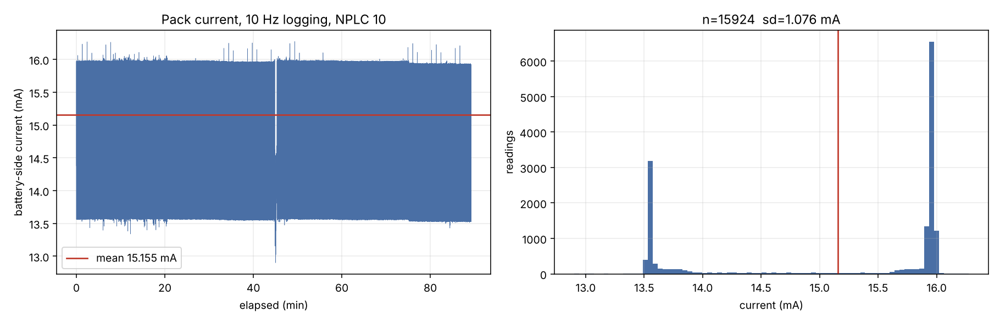

# Battery-Side Current Measurement — 2026-11-20

Measures what the **battery pack actually delivers**, as opposed to what the Nano
consumes. Earlier work (`power_analysis.md`) characterised the 5 V load side only;
that number cannot predict runtime, because the boost converter's losses sit between
the pack and the load.

---

## Summary

| Quantity | Value |
|---|---|
| **Battery-side average current** | **15.155 mA** |
| Standard deviation | 1.076 mA |
| Minimum / Maximum | 12.900 / 16.274 mA |
| Readings | 15,924 |
| Collection duration | 89.2 min |
| Pack voltage at start | 3.712 V |
| Load-side current (prior, DAQ) | 8.40 mA @ 5.03 V |
| **Implied boost efficiency** | **~75 %** |
| ~~Projected runtime, one pack~~ | ~~~16 days~~ — **see revision below** |

**Headline: at the professor-specified 10 Hz sample rate the system draws
15.2 mA from the pack.** That current measurement stands. The runtime figure
derived from it does not — see below.

---

## REVISION 2026-11-23 — the ~16 day runtime figure is withdrawn

The 16-day projection came from the six-day soak test's voltage decay:
4.14 V → 3.71 V over 164.9 h, read as ~43 % of a 3P pack.

**That soak test ran on a holder whose cells were not all connected.** The 2019
holder design has a stack-up error that leaves the retaining spring coil-bound
with zero travel, so cell contact is intermittent and position-dependent — see
[`../mechanical/battery_holder_stackup.md`](../mechanical/battery_holder_stackup.md).
A later run demonstrated the effect directly: cell 1 fell 12 mV while cells 2
and 3 did not move at all, i.e. **one cell carried the entire load**.

So the soak test measured the decay of an effectively 1P-to-2P pack and the
43 %-of-10,500 mAh reading was never valid. The implied "~5,400 mAh real
capacity" conclusion is withdrawn with it.

**The cells are fine.** A single cell charged from 4.036 V accepted **706 mAh**
to reach a rested 4.217 V, which back-calculates to ~3,500 mAh at a starting SOC
of ~80 % — consistent with genuine INR18650-35E.

### Revised runtime, from energy rather than voltage decay

Load is constant power, so work in energy:

```
output            8.40 mA x 5.03 V          =  42.3 mW
input at 75 %     42.3 / 0.75               =  56.3 mW
pack energy       10,500 mAh x 3.6 V        =  37,800 mWh
runtime           37,800 / 56.3             =  671 h  =  28.0 days
at 90 % usable    34,020 / 56.3             =  604 h  =  25.2 days
```

| Configuration | Runtime |
|---|---|
| One pack, nameplate | ~28 days |
| One pack, 90 % usable | ~25 days |
| **Two packs** | **~50–56 days** |

**One pack lands at 25–28 days: short of 30, with no margin.** Cold water makes
it worse — low temperature raises internal resistance and cuts usable capacity —
and boost efficiency falls as the pack voltage drops, so the back end of the
discharge is worse than linear.

**Recommendation: two packs.** The deficit is small but it is on the wrong side
of the requirement, and there is no headroom for a cold deployment or a delayed
retrieval.

**Outstanding:** the 15.155 mA figure was measured with the faulty holder and
the BMS in circuit. Neither should change it materially — the load is constant
power and a BMS idles in the tens of microamps — but it is worth re-measuring
for 20 minutes on the final build before the number goes in a report.

---

## Method

### Breakpoint

Current must be measured **in series**, which means breaking the circuit. The inline
blade-fuse holder between the XT30 pack connector and BMS `B+` was used as the
breakpoint — pull the fuse and the positive line is open at exactly the right place,
upstream of the BMS, boost converter and load. No desoldering required.

The DAQ's probe tips do not seat in the recessed spade clips of the waterproof
holder. A short adapter (stiff wire into each clip, instrument leads clipped to the
free ends) was used instead. **Contact integrity is critical** — an intermittent joint
browns out the Nano and the resulting boot current contaminates the average.

### Instrument configuration — Keithley DAQ6510

| Setting | Value | Why |
|---|---|---|
| Function | DC Current (`DCI`) | — |
| Terminals | `FRONT`; red in **AMPS**, black in **INPUT LO** | current does not pass through the voltage input |
| Range | 100 mA, **manual** | Auto hunts between ranges mid-burst and corrupts the average |
| NPLC | **10** (167 ms aperture @ 60 Hz) | see below |
| Auto Zero | On | — |
| Buffer | `defbuffer1`, statistics pane | mean over the whole buffer, not a live instant |

### Why a long integration aperture is mandatory

The MT3608 is a switching converter. At our light load (≈42 mW) it has far more
energy per switching pulse than the output needs, so it **pulse-skips**: a burst of
switching cycles charges the output capacitor, then it coasts with near-zero input
current until the output droops, then bursts again.

A handheld DMM samples two or three times a second and reports whichever instant it
lands on. During this work a Plusivo DM401B on the same breakpoint read anywhere
from **11 mA to 72 mA** with no stable value — every one of those readings was real,
none was the average. This is aliasing, not instrument error.

NPLC 10 gives a 167 ms integration window per reading, longer than the firmware's
100 ms sample cycle, so each individual reading averages across whole burst-and-coast
cycles rather than sampling instants of them.

### Procedure

1. Record pack voltage before switching the meter to current mode.
2. Battery disconnected: confirm the meter reads its zero (553 nA offset, 297 nA
   noise — four orders of magnitude below the signal).
3. Connect battery. Confirm the live reading jumps into the milliamps. **A reading
   that stays in µA means the meter is not in the current path** — most commonly the
   real fuse is still installed alongside the adapter and is carrying the current.
4. Wait **3 minutes** for boot, SD init and file creation to pass.
5. `Clear Active Buffer` — *after* the settle, not before.
6. Collect undisturbed. Any drop to zero means the contact broke; clear and restart.
7. Read Average / Std Dev / Min / Max / Span; export `defbuffer1` to USB
   (`MENU → Measure → Reading Buffers`).

---

## Results



Raw export: [`../data/daq_battery_side_20261120.csv`](../data/daq_battery_side_20261120.csv)

### Distribution

The readings are **bimodal**, with sharp peaks at ≈13.55 mA (24 % of readings) and
≈15.92 mA (57 %), and a flat spread between them.

| Bin | Readings | Share |
|---|---|---|
| 13.46 – 13.60 mA | 3,832 | 24.1 % |
| 15.85 – 15.99 mA | 9,100 | 57.1 % |
| everything else | 2,992 | 18.8 % |

This is **not** two operating states of the logger. It is a beat artifact: the 167 ms
aperture and the 100 ms sample cycle are not an integer ratio, so each reading
straddles either one or two sensor-on bursts depending on phase. Averaging over 89
minutes and thousands of beat cycles washes it out completely — which is precisely
why the buffer mean, not the live display, is the answer.

Standard error on the mean is 0.0085 mA. Readings are serially correlated by the beat
pattern so the effective sample count is lower, but the mean is good to well under
0.1 mA.

### Workload validation

A current measurement is only valid if the system was performing its full duty cycle
during it. Confirmed from the SD card:

| File | Samples | Duration | Rate |
|---|---|---|---|
| `LOG0005.CSV` | 19,007 | 1,905.4 s | **9.975 Hz** |

Sensors reading normally (s1≈155, s2≈121, s3≈129, s4≈974, s5≈974, s6≈967). The logger
was reading all six channels, timestamping and writing to SD at full rate throughout.
Had SD init failed, the write cycle — the most expensive part of each sample — would
have been skipped and the measurement would have under-reported the real draw.

`time_valid = 0` on all rows and timestamps at the 2000-01-01 epoch, as expected:
the RTC was not anchored for this bench run. See the open item below.

---

## Runtime analysis

### Pack capacity

The six-day soak test (`battery_bringup.md`) took the pack from **4.14 V to 3.71 V
over 164.9 hours**. At 15.155 mA that is ≈2,500 mAh consumed.

On a Li-ion discharge curve 4.14 V ≈ 85 % SOC and 3.71 V ≈ 42 % SOC, so that 2,500 mAh
represents roughly **43 % of the pack** — implying a real usable capacity near
**5,800 mAh against a 10,500 mAh nameplate**. Roughly half the rating, which is common
for unbranded cells.

**Treat the capacity figure as an inference**, since voltage is a poor fuel gauge in
Li-ion's flat middle region. The runtime projection does not depend on it: the pack
visibly consumed 43 % of its usable voltage window in 6.87 days, which scales directly
to **≈16 days from a full charge** whatever the true mAh figure turns out to be. The
current measurement and the capacity estimate move together and cancel.

Cold water will make this worse, not better — low temperature raises internal
resistance and reduces usable capacity.

### The 10 Hz constraint

Deep sleep (`POWER_DOWN`) would cut the idle floor dramatically, because the 7.34 mA
between-sample current is mostly the 16 MHz oscillator. But when that oscillator stops,
Timer1 stops with it, so Timer1 cannot be the wake source. The only wake sources that
survive `POWER_DOWN` are:

| Source | Available periods | Nearest to 100 ms |
|---|---|---|
| Watchdog timer | 16/32/64/125/250/500 ms … | 125 ms = **8 Hz** |
| DS3231 `SQW` → INT0 | 1 Hz, 1.024/4.096/8.192 kHz | 1 Hz |
| Pin change / INT0/1 | external only | n/a |

**There is no way to obtain exactly 10 Hz from a wake source that survives deep sleep
on this hardware.** At 10 Hz, `IDLE` is forced and 15.2 mA is close to the floor.

Remaining savings available at 10 Hz — power-reduction register for unused
peripherals, ADC off between reads, RAM-buffering SD writes instead of writing every
sample — are worth perhaps 15.2 → 11 mA, taking 16 days to about 19. Real, but not
sufficient.

### Decision matrix

| | One pack | Two packs in parallel |
|---|---|---|
| **10 Hz** (15.2 mA, measured) | **~16 days** | ~32 days |
| **8 Hz** (WDT + `POWER_DOWN`, ~7 mA est.) | ~32 days | ~64 days |

Relaxing either constraint meets the 30-day target. Holding both does not. This is a
science-requirements decision (is 8 Hz equivalent to 10 Hz for oyster gape, which
occurs over seconds to minutes?) and belongs to the PI, not to the firmware.

---

## Notes and cautions

- **Removing the BMS does not extend runtime.** A 1S protection board idles in the
  tens of microamps against our ~15,000 µA — about 0.1 % of consumption. The only
  gain is discharging past its cutoff, worth 2–3 % of capacity, roughly twelve hours.
  The cost is real: below ~2.5 V/cell, copper dissolves from the anode current
  collector and replates as dendrites on recharge, which can short the cell
  internally. Not acceptable in a sealed tube underwater.
- **Measure the battery side, not the load side.** The load-side figure omits
  converter losses and under-predicts drain by ~45 % in this system.
- **Do not use a handheld DMM for this measurement.** See the aliasing discussion
  above.

## Open items

- Replace compile-time RTC anchoring (`rtc.adjust(DateTime(F(__DATE__), F(__TIME__)))`)
  with a serial epoch input. Compile-time anchoring put the soak-test timestamps
  ~74 days adrift.
- PI decision on 8 Hz vs 10 Hz.
- Second pack procurement if 10 Hz is retained. Parallel packs must be voltage-matched
  before connection.
